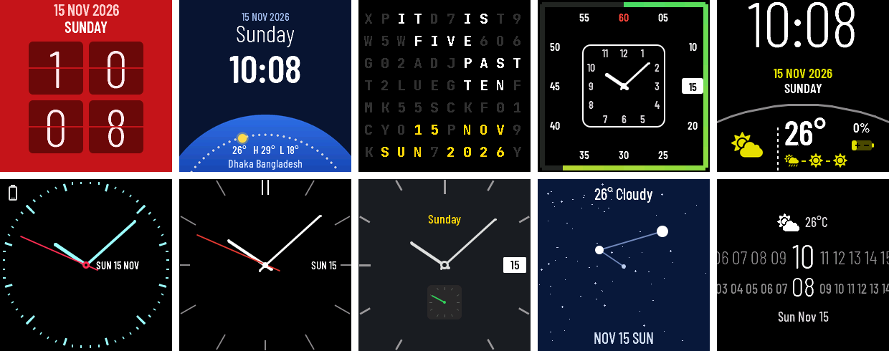

# Concept Faces for InfiniTime

Two watch faces for the [PineTime](https://pine64.org/devices/pinetime/) running
[InfiniTime](https://github.com/InfiniTimeOrg/InfiniTime), adapted from the Pebble watch face
concepts posted in [*Concept watch faces, developers are welcome to develop these*](https://www.reddit.com/r/pebble/comments/6wxhp3/concept_watch_faces_developers_are_welcome_to/)
on r/pebble — thanks to their designer for sharing them. Packaged with an `infinitime-app.json`
manifest so InfiniTime Builder can add them to your firmware.

## Tiles

The time as four big digits on dark red flip-clock tiles, with the date and weekday above.
Shows AM/PM when the watch is set to 12-hour time.

## Horizon

Date, weekday and time above a dome. A sun travels along the dome's dotted arc from today's
sunrise to sunset, and a moon crosses it at night. Below the arc are the current temperature,
today's high and low, and your location.

Sunrise, sunset and weather come from your phone's companion app (Gadgetbridge, InfiniLink, ...).
Without weather data the sun assumes 6:00 to 18:00.

## Install

1. In **InfiniTime Builder**, add `ScanuNicco/infinitime-concept-faces` under **Sources**.
2. Switch **Tiles** and/or **Horizon** on under **Watch faces**, and build.
3. Install the firmware, **then also send the `infinitime-resources-*.zip`** to the watch —
   these faces use custom fonts and images stored on the watch's external flash. Until the
   resource pack is installed they show greyed out in the watch face list.
4. Pick the face on the watch under *Settings > Watch face*.

Requires InfiniTime 1.16 or later. Tested on 1.16.1 in the [InfiniEmu](https://github.com/pipe01/InfiniEmu)
emulator (the screenshots), including 12/24-hour time and day/night.

## How the resources work

Each face declares its fonts and images in [`infinitime-app.json`](infinitime-app.json), in the
same format as InfiniTime's own `src/resources/fonts.json` and `images.json`. They end up in the
resource pack as `/fonts/<name>.bin` and `/images/<name>.bin`; the faces check for them in
`IsAvailable()`, load fonts with `lv_font_load("F:/fonts/...")` and images with
`lv_img_set_src(img, "F:/images/...")`, and fall back to built-in fonts if something is missing.

Fonts are loaded into RAM, so each font only contains the characters the face shows
(about 5 KB of fonts for Tiles and 8 KB for Horizon). The Horizon images and the sun-path coordinates in
`WatchFaceHorizon.cpp` are generated by [`tools/make_images.py`](tools/make_images.py).

## Credits and license

Designs: adapted from the [concept watch faces on r/pebble](https://www.reddit.com/r/pebble/comments/6wxhp3/concept_watch_faces_developers_are_welcome_to/),
shared by their designer for developers to build.

Code: GPL-3.0, like InfiniTime. Fonts: [Barlow Condensed](https://github.com/jpt/barlow), SIL Open
Font License 1.1 (see [`fonts/OFL.txt`](fonts/OFL.txt)).
